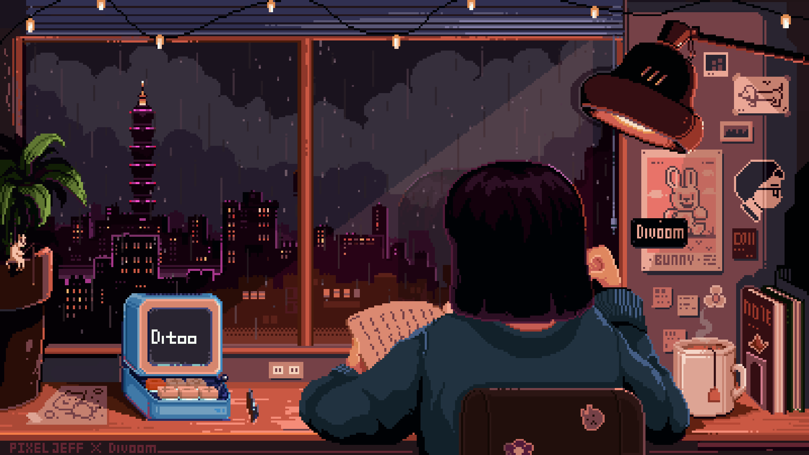

<h1 align="center">Hi  I'm Shivani Vishwakarma</h1>

<h3 align="center">Java Developer | Full-Stack Developer | Gen AI | Backend Development</h3>

- 🔭 I'm currently building <b>Full Stack & Backend Projects</b>

- 🌱 I'm currently learning <b>Spring Boot, Redis, Docker, Gen AI</b>

- 👯 I'm looking to collaborate on <b>Java, MERN & GenAI Projects</b>

- 👨‍💻 Explore my portfolio: <a href="https://my-portfolio-xi-seven-84.vercel.app/">portfolio</a>

- 📫 How to reach me: <b>sv723596@gmail.com</b>

- 🎯 My goal: <b>Software Engineer</b>

 

<h3>Connect with me :)</h3>

  
  

<h3>Languages and Tools:</h3>

  
  
  
  
  
  
  
  
  
  
  
  
  
  
  

  

  
  

<h3>🐍 Snake eating my contributions</h3>

  <picture>
    <source media="(prefers-color-scheme: dark)" srcset="https://raw.githubusercontent.com/shivani-009/shivani-009/output/github-contribution-grid-snake-dark.svg" />
    <source media="(prefers-color-scheme: light)" srcset="https://raw.githubusercontent.com/shivani-009/shivani-009/output/github-contribution-grid-snake.svg" />
    
  </picture>

<h3>Featured Projects</h3>

<ul>
  <li>🤖 <b>My Gemini</b> — AI chatbot using Gemini API (<a href="https://github.com/shivani-009?tab=repositories">repo</a>)</li>
  <li>⚡ <b>Traffic Control Gateway</b> — Spring Boot + Redis API Gateway (<a href="https://github.com/shivani-009?tab=repositories">repo</a>)</li>
  <li>🌐 <b>Portfolio Website</b> — Personal portfolio deployed on Vercel (<a href="https://my-portfolio-xi-seven-84.vercel.app/">live</a>)</li>
  <li>📚 <b>Tutor Finder Website</b> — Location-based tutor search platform (<a href="https://github.com/shivani-009?tab=repositories">repo</a>)</li>
</ul>

  

